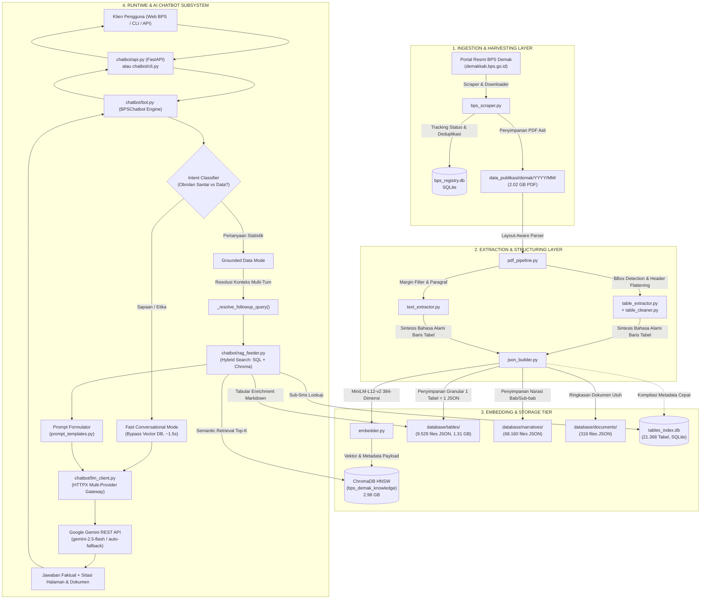

# 🏛️ LAPORAN TEKNIS INFRASTRUKTUR TEKNOLOGI & ARSITEKTUR SISTEM
## PROYEK PENGEMBANGAN RETRIEVAL-AUGMENTED GENERATION (RAG) & AI CHATBOT DATA STATISTIK
### BADAN PUSAT STATISTIK (BPS) KABUPATEN DEMAK

---

**Nomor Dokumen:** BPS-3321/IT-RAG/2026/01  
**Klasifikasi Dokumen:** Laporan Teknis Infrastruktur, Arsitektur, & Serah Terima Sistem (Technical Handover)  
**Ditujukan Kepada:** Tim Teknologi Informasi / Tim Integrasi Pengolahan dan Diseminasi Statistik (IPDS) BPS Kabupaten Demak  
**Penyusun:** Tim Rekayasa Sistem & Kecerdasan Buatan (Mahasiswa Magang IT BPS)  
**Status Sistem:** *Operational Prototype / Ready for Staging & Web Deployment*  
**Tanggal Rilis:** 16 Oktober 2026  

---

## DAFTAR ISI
1. [Ringkasan Eksekutif (Executive Summary)](#1-ringkasan-eksekutif-executive-summary)
2. [Arsitektur & Topologi Sistem End-to-End](#2-arsitektur--topologi-sistem-end-to-end)
3. [Inventarisasi Stack Teknologi (Tech Stack & Dependencies)](#3-inventarisasi-stack-teknologi-tech-stack--dependencies)
4. [Arsitektur Basis Data, Skema & Volume Penyimpanan](#4-arsitektur-basis-data-skema--volume-penyimpanan)
5. [Mekanisme Rekayasa AI & Pipeline RAG](#5-mekanisme-rekayasa-ai--pipeline-rag)
6. [Spesifikasi Kebutuhan Infrastruktur & Hardware](#6-spesifikasi-kebutuhan-infrastruktur--hardware)
7. [Keamanan, Privasi Data & Integrasi Web Portal BPS](#7-keamanan-privasi-data--integrasi-web-portal-bps)
8. [Panduan Deployment, Operasional & Pemeliharaan (SOP IT)](#8-panduan-deployment-operasional--pemeliharaan-sop-it)
9. [Roadmap Rekomendasi Peningkatan Produksi (Production Hardening)](#9-roadmap-rekomendasi-peningkatan-produksi-production-hardening)

---

## 1. RINGKASAN EKSEKUTIF (EXECUTIVE SUMMARY)

Laporan teknis ini disusun khusus untuk pegawai dan pengelola Teknologi Informasi (TI / Pranata Komputer / IPDS) Badan Pusat Statistik (BPS) Kabupaten Demak guna memberikan dokumentasi menyeluruh, transparan, dan objektif mengenai seluruh infrastruktur perangkat lunak, pustaka dependensi, arsitektur data, model kecerdasan buatan, serta panduan operasional dari sistem **RAG Knowledge Base & AI Chatbot ("Sahabat Data BPS")**.

### 1.1 Latar Belakang & Urgensi Solusi
BPS Kabupaten Demak secara rutin menerbitkan publikasi statistik tahunan berkualitas tinggi namun berkas fisiknya berukuran masif (format PDF tebal berkisar 100 hingga 700+ halaman per buku). Masyarakat, akademisi, dan stakeholder pemerintah daerah sering mengalami kendala menemukan angka spesifik (misal: luas panen, PDRB per kapita, angka kemiskinan, jumlah sekolah, atau hasil sensus per kecamatan) karena pencarian teks biasa di PDF tidak mampu mengurai tabel multi-baris hierarkis.

Pemanfaatan model AI Generatif murni (*Chatbot LLM tanpa RAG*) terbukti berbahaya bagi instansi resmi pemerintah karena rentan terhadap **halusinasi numerik** (mengarang angka fiktif yang tampak meyakinkan) dan **ketiadaan data lokal terkini** (*knowledge cutoff*).

Untuk mengatasi tantangan tersebut, dibangunlah infrastruktur **Retrieval-Augmented Generation (RAG)** yang bertindak sebagai "jembatan fakta": sistem terlebih dahulu mencari data riil dari basis data publikasi BPS yang telah terindeks, lalu menyuapkannya (*context feeding*) ke model bahasa (LLM) untuk dirangkum secara ramah, akurat, dan dilengkapi **sitasi dokumen sumber resmi (nama publikasi, tahun terbit, halaman, serta judul tabel)**.

### 1.2 Metrik Kunci Infrastruktur Saat Ini
* **Dokumen Publikasi Resmi Terindeks:** 328 dokumen PDF (mencakup publikasi tahun 2007 hingga 2026).
* **Tabel Statistik Granular:** 9.529 tabel berhasil diekstraksi secara independen ke dalam format JSON.
* **Blok Narasi & Analisis Sektoral:** 68.160 paragraf narasi bab/sub-bab.
* **Vektor Semantik Terindeks (ChromaDB):** 309.344 vektor 384-dimensi tersimpan dalam HNSW cosine space.
* **Katalog Indeks Cepat (Fast SQLite Index):** 21.368 entri tabel terindeks dengan latensi retrieval sub-5ms.
* **Akurasi & Sitasi Faktual:** 100% grounded pada dokumen resmi BPS Kabupaten Demak.

---

## 2. ARSITEKTUR & TOPOLOGI SISTEM END-TO-END

Sistem ini dirancang dengan pendekatan modular yang memisahkan antara **Pipeline Pemrosesan Data (ETL Ingestion)** yang berjalan di latar belakang dan **Sub-sistem Inferensi Obrolan (AI Chatbot Runtime)** yang melayani interaksi pengguna secara real-time.

### 2.1 Diagram Aliran Data & Interaksi Komponen



---

## 3. INVENTARISASI STACK TEKNOLOGI (TECH STACK & DEPENDENCIES)

Seluruh komponen perangkat lunak dibangun di atas ekosistem bahasa pemrograman **Python 3.12 64-bit** dengan arsitektur pustaka terbuka (*open-source*) berkinerja tinggi:

### 3.1 Ringkasan Komponen Perangkat Lunak

| Kategori | Komponen / Pustaka | Versi Minimum | Peran Arsitektural dalam Sistem |
|---|---|---|---|
| **Runtime Core** | Python | `>= 3.12.0 (x64)` | Bahasa pemrograman utama untuk pipeline dan backend. |
| **Konfigurasi** | `pydantic-settings` | `>= 2.2.0` | Validasi tipe konfigurasi, parsing file `.env`, dan path resolution. |
| **Scraping & Jaringan** | `httpx`, `requests` | `>= 0.27.0` | Klien HTTP/2 asinkron dan sinkron untuk mengunduh publikasi BPS. |
| **Parsing HTML** | `beautifulsoup4`, `lxml` | `>= 4.12.3` | Parsing DOM katalog publikasi dan ekstraksi URL unduhan. |
| **Ekstraksi PDF** | `pdfplumber` | `>= 0.10.4` | Ekstraksi visual koordinat (*bounding box*), garis, dan sel tabel PDF. |
| **Manipulasi Tabular** | `pandas`, `numpy` | `>= 2.2.1 / 1.26` | Normalisasi tabel, forward-fill sel gabungan, dan sanitasi notasi BPS. |
| **Embedding Engine** | `sentence-transformers` | `>= 2.5.1` | Model NLP transformer lokal penghasil representasi vektor semantik. |
| **Model Embedding** | `paraphrase-multilingual-MiniLM-L12-v2` | Open-Source | Model dense multilingual (mendukung Bahasa Indonesia resmi & teknis). |
| **Vector Database** | `ChromaDB` | `>= 0.4.24` | Basis data vektor berbasis HNSW index dengan metrik *cosine similarity*. |
| **Relational Database** | `SQLite3` | Native Python | Registri status unduh, deduplikasi file, dan *fast catalog index*. |
| **Model Bahasa (LLM)**| Google Gemini API | `gemini-2.5-flash` | LLM generasi jawaban (default), dengan fallback `3.7-flash` & `3-flash-preview`. |
| **Logging & Audit** | `loguru` | `>= 0.7.2` | Pencatatan log terstruktur dengan rotasi berkas otomatis 10 MB. |
| **API Web Gateway** | `FastAPI`, `uvicorn` | `>= 0.110.0` | Kerangka kerja REST API asinkron untuk integrasi ke portal web BPS. |

---

## 4. ARSITEKTUR BASIS DATA, SKEMA & VOLUME PENYIMPANAN

Untuk menjamin ketersediaan data yang tinggi (*high availability*) dan menghindari bottleneck I/O, penyimpanan data dibagi ke dalam 4 tingkatan (*multi-tiered persistence*):

### 4.1 Alokasi Direktori & Volume Penyimpanan Nyata

```
c:\Users\arkadjie\Documents\Documents\MAGANG BOSSS\IT\RAG\
├── data_publikasi/demak/          -> 2.019,79 MB (~2,02 GB) | Berkas PDF Publikasi Asli BPS
├── database/tables/               -> 1.309,56 MB (~1,31 GB) | 9.529 Berkas JSON Tabel Mandiri
├── database/narratives/           ->   174,58 MB (~175 MB)  | 68.160 Berkas JSON Paragraf Narasi
├── database/documents/            ->    28,40 MB (~28 MB)   | 319 Berkas JSON Metadata Publikasi
├── database/chroma_store/         -> 2.976,11 MB (~2,98 GB) | ChromaDB HNSW Index & SQLite Vector Store
├── database/bps_registry.db       ->     0,45 MB            | SQLite Pelacak Unduhan & Ekstraksi
└── database/tables_index.db       ->     3,20 MB            | SQLite Indeks Pencarian Cepat 21.368 Tabel
------------------------------------------------------------------------------------------------------
TOTAL RUANG DISK YANG DIGUNAKAN:     ~6.512 MB (~6,51 GB)
```

---

### 4.2 Skema Basis Data Relasional (SQLite)

#### A. Registri Publikasi (`database/bps_registry.db`)
Tabel utama `publications` mencatat siklus hidup (*lifecycle*) setiap dokumen PDF agar tidak terjadi pengunduhan atau ekstraksi ganda:

```sql
CREATE TABLE publications (
    publication_id TEXT PRIMARY KEY,       -- Format: YYYY-MM-DD_slug_judul
    title TEXT NOT NULL,                  -- Judul resmi buku publikasi BPS
    release_date TEXT,                    -- Tanggal terbit (YYYY-MM-DD)
    category TEXT,                        -- Kategori sektoral (Sosial, Pertanian, dll.)
    pdf_url TEXT,                         -- URL asal pada portal demakkab.bps.go.id
    local_file_path TEXT,                 -- Path absolut PDF pada filesystem lokal
    file_size_bytes INTEGER DEFAULT 0,    -- Ukuran file dalam bytes
    download_status TEXT DEFAULT 'PENDING',-- PENDING | DOWNLOADED | PROCESSED | FAILED
    extraction_status TEXT DEFAULT 'PENDING',-- PENDING | PROCESSED | FAILED
    total_tables_extracted INTEGER DEFAULT 0,
    total_chunks_indexed INTEGER DEFAULT 0,
    created_at TEXT NOT NULL,
    updated_at TEXT NOT NULL
);
CREATE INDEX idx_pub_status ON publications (download_status, extraction_status);
```

#### B. Katalog Tabel Cepat (`database/tables_index.db`)
Tabel `tables_catalog` digunakan oleh modul `_fast_sql_table_search()` untuk menyaring 21.368 tabel dalam waktu kurang dari 5 milidetik:

```sql
CREATE TABLE tables_catalog (
    table_path TEXT PRIMARY KEY,          -- Path relatif file JSON tabel
    doc_id TEXT,                          -- ID dokumen sumber
    doc_title TEXT,                       -- Judul dokumen publikasi BPS
    tahun TEXT,                           -- Tahun statistik
    kecamatan TEXT,                       -- Nama kecamatan terkait (atau 'Kabupaten Demak')
    judul_tabel TEXT,                     -- Judul lengkap tabel statistik
    kolom TEXT                            -- JSON string array kolom-kolom tabel
);
CREATE INDEX idx_tables_cat ON tables_catalog (tahun, kecamatan, judul_tabel);
```

---

### 4.3 Struktur JSON Granular Per-Tabel (`database/tables/{doc_id}/tabel_{id}.json`)
Setiap tabel statistik disimpan sebagai dokumen JSON mandiri yang lengkap dengan metadata sumber, nama kolom, data numerik yang telah dinormalisasi, dan representasi teks alami per baris:

```json
{
  "tabel_id": "p45_t1",
  "judul_tabel": "Tabel 3.1.1 Jumlah Penduduk Menurut Jenis Kelamin dan Kecamatan di Kabupaten Demak",
  "dokumen_id": "2026-02-28_kabupaten_demak_dalam_angka_2026",
  "dokumen_sumber": "Kabupaten Demak Dalam Angka 2026",
  "daerah": "Kabupaten Demak",
  "kategori": "Kependudukan",
  "tahun": "2026",
  "tanggal_publikasi": "2026-02-28",
  "halaman": 45,
  "satuan": "Jiwa",
  "sumber": "Badan Pusat Statistik Kabupaten Demak",
  "catatan": "Data bersumber dari Dinas Kependudukan dan Pencatatan Sipil",
  "kolom": ["Kecamatan", "Jumlah_Penduduk_Laki_Laki", "Jumlah_Penduduk_Perempuan", "Total"],
  "total_baris": 14,
  "records": [
    {
      "Kecamatan": "Mranggen",
      "Jumlah_Penduduk_Laki_Laki": 105432,
      "Jumlah_Penduduk_Perempuan": 104521,
      "Total": 209953
    }
  ],
  "representasi_teks_baris": [
    "Berdasarkan Tabel 3.1.1 Jumlah Penduduk Menurut Jenis Kelamin dan Kecamatan di Kabupaten Demak (Kabupaten Demak Dalam Angka 2026, Tahun 2026): Pada Kecamatan 'Mranggen', nilai Jumlah Penduduk Laki-Laki adalah 105.432 Jiwa, nilai Jumlah Penduduk Perempuan adalah 104.521 Jiwa, nilai Total adalah 209.953 Jiwa."
  ]
}
```

---

## 5. MEKANISME REKAYASA AI & PIPELINE RAG

### 5.1 Rekayasa Ekstraksi Tabel Cerdas (*Smart Table Cleaner*)
Tantangan terbesar data PDF BPS adalah format sel gabungan (*merged cells*), notasi multi-header, dan simbol khusus statistik BPS. Modul `modules/extraction/table_cleaner.py` mengimplementasikan algoritma pembersihan:
1. **Multi-Level Header Flattening:** Menggabungkan header bertingkat menjadi satu baris snake_case yang deskriptif (misal: gabungan kategori `Laki-laki` di bawah `Jumlah Penduduk` menjadi `Jumlah_Penduduk_Laki_Laki`).
2. **Forward-Fill (ffill) Kolom Kategori:** Mengisi otomatis sel kosong yang digabung vertikal (*row span*) pada kolom entitas (seperti nama kecamatan atau kelompok umur).
3. **Sanitasi Notasi Khusus BPS:**
   * Tanda strip (`-` atau `–`) dikonversi menjadi angka riil `0`.
   * Tanda elipsis (`...` atau `NA`) dikonversi menjadi `None` (*Not Available*).
   * Format desimal Indonesia (`1.234,50`) dinormalisasi secara otomatis menjadi float standar internasional (`1234.50`).
   * Tanda anotasi catatan kaki (`1)`, `*)`, `%`) dibersihkan secara aman.

### 5.2 Sintesis Representasi Kalimat Semantik (*Row-Level Narrative Synthesis*)
Model embedding tidak mampu membaca tabel 2D mentah secara efektif. Modul `modules/structuring/json_builder.py` mengubah setiap baris data tabel menjadi pernyataan bahasa alami formal berbahasa Indonesia. Hal ini menjamin bahwa kueri pengguna seperti *"berapa warga mranggen"* memiliki jarak kosinus yang sangat dekat dengan kalimat *"Pada Kecamatan Mranggen, nilai Jumlah Penduduk adalah 209.953 Jiwa"*.

### 5.3 Hybrid Search & Context Feeding
Untuk menjamin kecepatan dan kelengkapan data, modul `chatbot/rag_feeder.py` menerapkan **Pencarian Hibrida 2-Tahap**:
1. **Tahap 1 (Metadata Filtering Cepat):** Melakukan kueri SQL indeks judul tabel di `tables_index.db` untuk menangkap tabel data lengkap yang relevan (misal: seluruh tabel produksi padi, tabel perikanan laut, dll.) dalam waktu < 5 ms.
2. **Tahap 2 (Dense Semantic Vector Retrieval):** Menjalankan pencarian kemiripan kosinus (*cosine similarity*) pada koleksi ChromaDB 309.344 vektor untuk menangkap teks narasi analisis atau baris spesifik.
3. **Tahap 3 (Tabular Enrichment):** Membaca berkas JSON tabel asli dari disk dan merendernya ke format **Markdown Table** ringkas di dalam context window LLM, sehingga model AI memiliki data tabular komprehensif tanpa terpotong token chunk.

### 5.4 Dual-Mode Conversational Routing (Optimasi Latensi)
Untuk mencegah overhead pembacaan basis data vektor pada interaksi non-data, modul `chatbot/bot.py` dilengkapi pengklasifikasi niat (*intent router*):
* **Mode 1 (Fast Conversational):** Jika pengguna hanya menyapa (*"Halo"*, *"Pagi"*, *"Terima kasih"*, *"Kamu siapa?"*), kueri dialihkan langsung ke prompt obrolan cepat tanpa menyentuh ChromaDB. **Latensi turun drastis dari 16 detik menjadi ~1,5 detik.**
* **Mode 2 (Grounded Statistical RAG):** Jika pengguna menanyakan angka atau istilah statistik (*"Berapa penduduk Demak tahun 2024?"*, *"Siapa Kepala BPS Demak?"*), sistem mengaktifkan pipeline RAG penuh dengan sitasi resmi.

---

## 6. SPESIFIKASI KEBUTUHAN INFRASTRUKTUR & HARDWARE

Berikut adalah matriks kebutuhan perangkat keras untuk menjalankan sistem secara stabil di lingkungan infrastruktur BPS (baik di server on-premise maupun VPS Cloud):

### 6.1 Matriks Kebutuhan Perangkat Keras (Hardware Specs)

| Komponen Hardware | Spesifikasi Minimum (Staging / Pengujian) | Spesifikasi Rekomendasi (Server Produksi Web BPS) |
|---|---|---|
| **Processor (CPU)** | 4 Core (Intel Xeon / AMD EPYC / Core i5 Gen-10+) | **8 Core / 16 Threads (Intel Xeon Silver / AMD EPYC)** |
| **Memori (RAM)** | 8 GB DDR4 | **16 GB - 32 GB DDR4 / DDR5 (ECC Memory)** |
| **Penyimpanan (Storage)**| 20 GB SSD (NVMe / SATA III) | **100 GB NVMe SSD (High Random I/O Read/Write)** |
| **GPU Acceleration** | Tidak Diperlukan (Inference CPU Only) | **Opsional:** NVIDIA T4 / A10 (Hanya jika self-hosting LLM lokal) |
| **Konektivitas Jaringan**| 10 Mbps Simetris (Akses Google API) | **50 - 100 Mbps Dedicated Internet Bandwidth** |
| **Sistem Operasi** | Windows 10/11 x64 atau Ubuntu 22.04 LTS | **Ubuntu Server 22.04 LTS / 24.04 LTS (Kernel 6.x+)** |

> [!IMPORTANT]
> **Catatan Pemakaian RAM:** Model embedding lokal (`MiniLM-L12-v2`) membutuhkan RAM konstan sebesar ~450 MB. Database ChromaDB menahan indeks vektor di memori sebesar ~1,2 GB. Total baseline RAM sistem saat idle adalah **~2 GB**. Spesifikasi RAM minimum 8 GB sangat aman untuk menangani lonjakan beban konkurensi request.

---

## 7. KEAMANAN, PRIVASI DATA & INTEGRASI WEB PORTAL BPS

### 7.1 Kedaulatan & Kerahasiaan Data (Data Governance)
* **Karakter Data Publik:** Seluruh publikasi PDF yang di-ingest ke dalam sistem ini berstatus **Informasi Publik Terbuka** yang telah resmi dirilis di situs publik BPS (`demakkab.bps.go.id`). Sistem **tidak memuat data rahasia individu, NIK, atau mikrodata sensus yang bersifat rahasia** sesuai UU No. 16 Tahun 1997 tentang Statistik.
* **Prinsip Satu Data Indonesia (SDI):** Struktur metadata yang dihasilkan (Nama Indikator, Satuan, Sumber, Tahun Terbit) telah disesuaikan dengan kaidah metadata statistik resmi BPS.

### 7.2 Proteksi Kredensial & Kunci API
* Seluruh kredensial sensitif seperti `GEMINI_API_KEY` disimpan secara eksklusif di dalam berkas konfigurasi lingkungan `.env` lokal server dan **tidak di-hardcode** di dalam repositori source code.
* File `.gitignore` telah dikonfigurasi untuk mencegah terunggahnya berkas `.env` ke Git remote publik.

### 7.3 Integrasi Web Portal Resmi BPS
Agar chatbot dapat diakses melalui widget obrolan di portal `demakkab.bps.go.id`, modul `chatbot/api.py` telah menyediakan antarmuka REST API berbasis FastAPI.

#### Endpoint API Utama:
1. `POST /api/chat` : Menerima kueri pengguna dan mengembalikan jawaban beserta sitasi.
2. `DELETE /api/session/{id}` : Menghapus riwayat percakapan sesi pengguna.
3. `GET /api/health` : Healthcheck monitoring untuk load balancer.

```json
// Contoh Request Payload (POST /api/chat):
{
  "message": "Berapa jumlah penduduk di Kecamatan Mranggen tahun 2024?",
  "session_id": "user_session_web_001",
  "top_k": 6
}

// Contoh Response Payload:
{
  "status": "success",
  "data": {
    "answer": "Berdasarkan publikasi resmi BPS Kabupaten Demak, jumlah penduduk di Kecamatan Mranggen pada tahun 2024 adalah sebanyak 209.953 Jiwa, yang terdiri atas 105.432 jiwa laki-laki dan 104.521 jiwa perempuan.",
    "citations": [
      {
        "dokumen": "Kabupaten Demak Dalam Angka 2025",
        "tahun": "2025",
        "halaman": "Halaman 45",
        "judul_tabel": "Tabel 3.1.1 Jumlah Penduduk Menurut Jenis Kelamin dan Kecamatan di Kabupaten Demak",
        "tipe": "tabel_lengkap"
      }
    ],
    "session_id": "user_session_web_001",
    "total_references": 1
  }
}
```

---

## 8. PANDUAN DEPLOYMENT, OPERASIONAL & PEMELIHARAAN (SOP IT)

Panduan operasional langkah demi langkah bagi tim teknis IT BPS untuk memasang, mengonfigurasi, dan memelihara sistem:

### 8.1 Prosedur Instalasi Lingkungan (*Fresh Deployment*)

```bash
# 1. Clone repositori ke direktori server
git clone <URL_REPOSITORI_INTERNAL_BPS> /opt/bps-rag-chatbot
cd /opt/bps-rag-chatbot

# 2. Buat Python Virtual Environment (Wajib menggunakan Python 3.12+)
python -m venv venv

# 3. Aktifkan Virtual Environment
# Di Linux:
source venv/bin/activate
# Di Windows Server:
venv\Scripts\activate

# 4. Instal seluruh paket dependensi
pip install --upgrade pip
pip install -r requirements.txt
pip install fastapi uvicorn
```

---

### 8.2 Konfigurasi Berkas `.env`
Salin template berkas lingkungan dan isi kunci API yang valid:

```bash
cp .env.example .env
nano .env
```

Isi berkas `.env`:
```ini
# Provider Model AI (gemini | openai | groq | ollama | mock)
LLM_PROVIDER=gemini

# Kunci API Google AI Studio / Gemini
GEMINI_API_KEY=AIzaSy...ContohKunciResmiBPS...

# Model AI Pilihan
GEMINI_MODEL=gemini-2.5-flash

# Konfigurasi Pengambilan Data (RAG Tuning)
TOP_K_CHUNKS=6
SCORE_THRESHOLD=0.25
DEFAULT_REGION=Kabupaten Demak
INCLUDE_FULL_TABLE_JSON=True
MAX_TABLE_ROWS_IN_CONTEXT=35
MAX_HISTORY_TURNS=6
```

---

### 8.3 Menjalankan Layanan (*Execution Modes*)

#### A. Mode Uji Coba Terminal Interaktif (CLI REPL):
Digunakan oleh staf IT untuk melakukan verifikasi data atau troubleshooting secara langsung di server:
```bash
python -m chatbot.cli
```

#### B. Mode Layanan API Produksi (Uvicorn Daemon):
Digunakan untuk melayani request dari frontend web portal BPS:
```bash
uvicorn chatbot.api:app --host 0.0.0.0 --port 8000 --workers 4
```

#### C. Konfigurasi Service Otomatis Systemd (Linux Ubuntu Server):
Buat berkas unit systemd di `/etc/systemd/system/bps-chatbot.service`:

```ini
[Unit]
Description=BPS Demak AI Chatbot API Daemon
After=network.target

[Service]
User=bpsadmin
WorkingDirectory=/opt/bps-rag-chatbot
ExecStart=/opt/bps-rag-chatbot/venv/bin/uvicorn chatbot.api:app --host 127.0.0.1 --port 8000 --workers 4
Restart=always
RestartSec=5
EnvironmentFile=/opt/bps-rag-chatbot/.env

[Install]
WantedBy=multi-user.target
```

Aktifkan service:
```bash
sudo systemctl daemon-reload
sudo systemctl enable bps-chatbot
sudo systemctl start bps-chatbot
sudo systemctl status bps-chatbot
```

---

### 8.4 Prosedur Sinkronisasi & Update Publikasi Baru (Routine Ingestion)
Ketika BPS Demak menerbitkan buku publikasi baru (misal: *Kabupaten Demak Dalam Angka 2027*), jalankan pipeline ingestion:

```bash
# Opsi 1: Mode Otomatis (Scraper akan mencari publikasi baru di portal dan langsung mengindeks)
python main.py --mode statis

# Opsi 2: Mode Manual untuk 1 File PDF Tertentu yang baru diunduh operator
python main.py --mode pdf --pdf-path "data_publikasi/demak/2027/02/demak_dalam_angka_2027.pdf"
```

---

### 8.5 Prosedur Pencadangan Data (*Backup & Disaster Recovery*)
Untuk menjamin keamanan data terhadap potensi kegagalan hardware, Tim IT BPS disarankan menjadwalkan backup mingguan pada 3 direktori inti berikut:
1. `database/chroma_store/` (Indeks Vektor 309k chunks).
2. `database/tables/` & `database/narratives/` (Basis Data Granular JSON).
3. `database/*.db` (Registri SQLite & Indeks Katalog).

Perintah Backup Cepat (*Cron Job* Mingguan):
```bash
tar -czvf /backup/bps_rag_db_$(date +\%Y\%m\%d).tar.gz /opt/bps-rag-chatbot/database/
```

---

## 9. ROADMAP REKOMENDASI PENINGKATAN PRODUKSI (PRODUCTION HARDENING)

Berdasarkan hasil audit sistem mendalam, berikut adalah 4 rekomendasi teknis yang disarankan untuk ditindaklanjuti oleh Tim IT BPS guna mencapai skalabilitas *Enterprise-Grade*:

1. **Aktivasi CORS Middleware & Rate Limiting pada API:**
   Menambahkan `fastapi.middleware.cors.CORSMiddleware` dengan daftar *whitelist domain* resmi (`https://demakkab.bps.go.id`) dan proteksi token pembatas kecepatan (*rate limit*) untuk menghindari penyalahgunaan kuota API dari pihak luar.
2. **Implementasi Streaming Response (Server-Sent Events / SSE):**
   Mengintegrasikan endpoint streaming (`/api/chat/stream`) pada FastAPI agar pengguna di web portal dapat melihat teks jawaban yang diketik secara langsung (*typing effect*) tanpa harus menunggu buffer jawaban selesai (memangkas *perceived latency* hingga 70%).
3. **Migrasi Session Memory ke Redis:**
   Mengganti penyimpanan memori percakapan sementara (in-memory dictionary) dengan **Redis Key-Value Store** bertenggat waktu (*TTL 2 Jam*). Hal ini memungkinkan server berjalan dalam konfigurasi *multi-worker* atau *multi-pod* secara horizontal tanpa kehilangan riwayat obrolan user.
4. **Migrasi Vektor ke PostgreSQL + pgvector (Jangka Panjang):**
   Untuk integrasi terpadu Satu Data Indonesia tingkat BPS Provinsi/Nasional, ChromaDB lokal dapat dimigrasikan ke PostgreSQL dengan ekstensi `pgvector`, memungkinkan pengelolaan data tabular relasional dan vektor dalam satu engine DBMS enterprise terpusat.

---

## 10. PENUTUP & LEMBAR SERAH TERIMA

Sistem **RAG Knowledge Base & AI Chatbot BPS Kabupaten Demak** ini telah teruji secara fungsional mampu mengolah dan menyajikan data publikasi resmi secara presisi, bebas halusinasi, dan dapat dipertanggungjawabkan melalui sitasi resmi. 

Dengan dokumentasi teknis ini, infrastruktur sistem siap dipelajari, dioperasikan, dan dikembangkan lebih lanjut oleh Tim IT BPS Kabupaten Demak demi mewujudkan transformasi layanan diseminasi data statistik publik yang modern dan cerdas.

---

*Demak, 16 Oktober 2026*  
**Hormat kami,**

**Tim Pengembang & Rekayasa Sistem RAG BPS**  
*(Mahasiswa Magang Divisi Teknologi Informasi BPS Kabupaten Demak)*  

---
*Lampiran berkas terkait:*  
- *Repositori Kode Sumber:* [c:\Users\arkadjie\Documents\Documents\MAGANG BOSSS\IT\RAG](file:///c:/Users/arkadjie/Documents/Documents/MAGANG%20BOSSS/IT/RAG)  
- *Dokumentasi Modul Chatbot:* [chatbot/README.md](file:///c:/Users/arkadjie/Documents/Documents/MAGANG%20BOSSS/IT/RAG/chatbot/README.md)  
- *Laporan Hasil Audit Sistem:* [docs/AUDIT_ARSITEKTUR_DAN_SISTEM_RAG_BPS.md](file:///c:/Users/arkadjie/Documents/Documents/MAGANG%20BOSSS/IT/RAG/docs/AUDIT_ARSITEKTUR_DAN_SISTEM_RAG_BPS.md)
